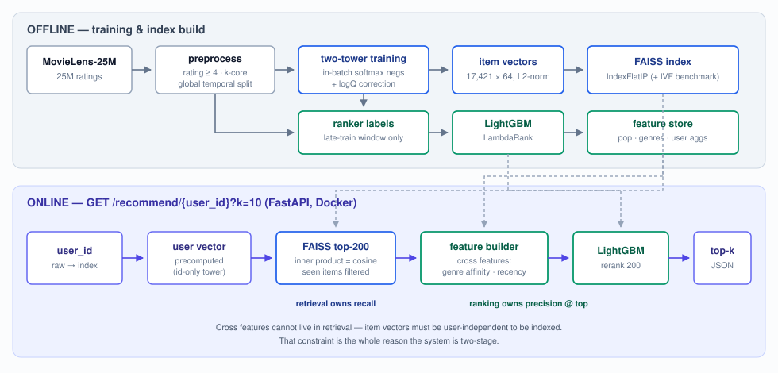

# Deepretrieve — Two-Stage Neural Recommendation System

A production-shaped recommender on MovieLens-25M: a **two-tower retrieval model**
(PyTorch, in-batch softmax negatives with logQ popularity correction) narrows the
catalog to 200 candidates via a **FAISS** index, and a **LightGBM LambdaRank
reranker** with cross features orders the top of the list. Served end-to-end with
**FastAPI** in **Docker**. Evaluated honestly: leakage-free temporal split,
full-catalog ranking (no sampled negatives), tested metrics, and per-component
ablations.



## Results

Full-catalog ranking on the temporal test split — every test user is scored
against all 17,421 items minus their train history. Ground truth is that user's
test-window positives. No sampled negatives. Reproduced by the commands below;
raw numbers in [`results/final_eval.md`](results/final_eval.md) and
[`results/eval.csv`](results/eval.csv).

| System | Recall@10 | NDCG@10 | Recall@100 | NDCG@100 |
|---|---|---|---|---|
| Popularity | 0.0265 | 0.0540 | 0.1333 | 0.0799 |
| Item-kNN | 0.0356 | 0.0691 | 0.1755 | 0.1026 |
| **Two-tower** | 0.0416 | 0.0792 | **0.2212** | 0.1250 |
| Two-tower (no logQ) — ablation | 0.0088 | 0.0171 | 0.0559 | 0.0296 |
| **Two-tower + LightGBM** | **0.0467** | **0.0837** | **0.2287** | **0.1308** |

Headline deltas:

- Two-tower over item-kNN: **+26.0% Recall@100**, +14.5% NDCG@10
- Two-tower over popularity: **+66.0% Recall@100**
- Reranker over retrieval-only: **+5.8% NDCG@10**, +3.4% Recall@100
- Full system over item-kNN: **+30.3% Recall@100**, +21.1% NDCG@10

**Removing the logQ correction is catastrophic, not marginal** — Recall@100 falls
from 0.2212 to 0.0559, well below the popularity baseline. The ablation run peaks
at epoch 1 (val Recall@100 0.0783) and then *degrades* every epoch until early
stopping. Without the correction the softmax keeps pushing down exactly the
popular items that dominate the test distribution, so training actively makes the
model worse. This was the single largest effect measured in the project.

**Why the reranker moves Recall@100 at all.** The expectation is that a reranker
lifts NDCG@10 and leaves Recall@100 flat, because the ranker can only reorder what
retrieval surfaced. It moved +3.4% here for a specific reason: the served system
retrieves **top-200** and reranks them, so items retrieval ranked 101–200 can be
promoted into the top-100. Recall@**200** is identical for both systems by
construction. Retrieval owns recall, ranking owns precision at the top — the small
Recall@100 lift is a candidate-window effect, not the ranker recovering anything
retrieval missed.

Also produced: [`results/ann_benchmark.md`](results/ann_benchmark.md),
[`results/feature_importance.csv`](results/feature_importance.csv) +
[`.png`](results/feature_importance.png),
[`results/latency.md`](results/latency.md), and the per-epoch training curve in
`artifacts/training_log.csv`.

### Dataset after preprocessing

| | |
|---|---|
| Raw | 25,000,095 ratings, 162,541 users, 59,047 rated movies |
| Implicit positives (rating ≥ 4.0) | 12,452,811 (49.8% kept) |
| After iterative 5-core filtering | 12,411,442 rows, 160,770 users, 19,935 items |
| Train / val / test | 9,929,153 / 146,229 / 85,715 rows |
| Modeled catalog | **135,766 users × 17,421 items** |
| Test users | **3,792** (see the caveat below — this matters) |
| Time spans | train ≤ 2016-06-08 · val → 2017-12-26 · test → 2019-11-21 |

### ANN: what approximation costs

17,421 items, dim 64, 2,000 queries, top-100. `IndexFlatIP` was verified to match
a brute-force numpy matmul at overlap **1.0000** before any IVF work.

| Index | nprobe | recall-vs-exact@100 | ms/query |
|---|---|---|---|
| Flat (exact) | – | 1.0000 | 0.016 |
| IVF nlist=446 | 8 | 0.8617 | 0.006 |
| IVF nlist=446 | 32 | 0.9935 | 0.005 |
| IVF nlist=446 | 128 | 0.9999 | 0.008 |

At this catalog size exact search is already ~16 µs/query, so IVF buys nothing
here and the ms/query column is within measurement noise (nprobe=32 timing below
nprobe=8 is noise, not a speedup). The recall column is the meaningful axis: it
quantifies what approximation would cost at a scale where you actually need it.
Reporting IVF as a "speedup" at 17K items would be dishonest.

### Serving latency

1,000 sequential requests, k=10, single uvicorn worker, one kept-alive
connection, measured on the host.

| Endpoint | p50 | p95 | p99 |
|---|---|---|---|
| `/health` (HTTP floor) | 1.0 ms | 1.6 ms | 2.0 ms |
| `/recommend_retrieval_only` | 1.8 ms | 2.6 ms | 2.9 ms |
| `/recommend` (retrieval + rerank) | **5.5 ms** | **6.2 ms** | 6.8 ms |

Reranking 200 candidates costs ~3.7 ms — consistent with an in-process
measurement of the handlers (3.04 ms vs 0.18 ms). In the Docker container the
same run gives `/recommend` p50 5.6 ms / p95 21.1 ms; cold start to first
served response is **7.5 s**, image size 1.2 GB.

## Design decisions & tradeoffs

- **Why two stages?** Cross features (user-genre affinity, recency gap) are what
  make ranking accurate, but a model with cross features cannot be served with
  ANN — item representations must be user-independent to precompute an index.
  So retrieval is a pure two-tower (servable, high recall) and cross features
  live in the reranker (small candidate set, precision at the top).
- **In-batch softmax negatives + logQ.** Each user's negatives are the other
  B−1 items in a 4096-sized batch. In-batch sampling picks negatives
  proportional to popularity, over-penalizing popular items; subtracting
  `log(p_item)` from the logits (sampled-softmax correction) fixes the bias.
  Ablated above — it is the difference between beating and losing to popularity.
- **Temporal split, not random.** Random splits of interaction data train on a
  user's future to predict their past. We cut at global timestamp quantiles
  (80/10/10) and drop val/test users/items unseen in train — **cold-start is
  deliberately out of scope** (stated extension, not a gap).
- **Implicit threshold at rating ≥ 4.0.** High-precision positives; noisy
  positives poison in-batch negative sampling because "negatives" are other
  users' positives. Keeps 49.8% of ratings. Rejected: threshold 3.5 (noisier),
  keep-all-weighted (complicates the loss for little gain here).
- **Full-catalog evaluation.** Sampled-negative evaluation (1 positive vs 100
  random negatives) is a known-biased shortcut; every number here is from
  ranking the entire catalog minus each user's train history. Train-history
  masking lives in the eval harness, not in the scorers, so no scorer can
  forget it.
- **L2-normalize + dot = cosine.** Bounds scores, stabilizes the softmax, and
  makes FAISS inner-product search equivalent to cosine search.
- **Exact FAISS first, IVF second.** Exact is verified against brute force
  before IVF is benchmarked, so the ANN recall column has a trustworthy
  reference point.
- **No torch in the serving image.** The user tower is id-only, so user vectors
  are precomputed at training time and the request path is numpy + FAISS +
  LightGBM. `requirements-serve.txt` omits torch; `requirements.txt` (training)
  keeps it.

## What didn't work

Five honest findings, each with a diagnosis. Three of them changed the numbers.

**1. The global temporal split leaves only 3,792 test users, and they are not a
random sample.** Dropping val/test rows whose user or item is unseen in train
removed **93% of test rows** (1,155,430 of 1,241,145). The cause is structural,
not a bug: train ends 2016-06 and the test window is 2017-12 → 2019-11, so almost
everyone interacting in the test window joined MovieLens after the train cutoff
and has no learned embedding. The survivors are heavy, long-tenured users —
median 142 train interactions vs 38 across all users. Consequence: every number
in the results table describes *users who stayed active across a 3.5-year gap*,
which is an easier and more predictable population than "all users". The
comparison between systems is still fair (all systems are scored on the same
users), but the absolute values should not be read as catalog-wide performance,
and a 3,792-user test set is small enough to be noisy. A per-user leave-one-out
temporal split would give ~135K test users, but it leaks one user's future into
another user's training window; that tradeoff was resolved in favour of the
stricter protocol.

**2. The latency benchmark was measuring the HTTP client, not the model.** The
first run reported `/recommend` p50 6.6 ms and `/recommend_retrieval_only` p50
14.3 ms — i.e. the *cheaper* endpoint looked 2× slower, which is impossible.
Diagnosis: the script opened a new TCP connection per request, and on Windows
loopback that adds a ~12 ms connect + delayed-ACK stall. Bare `/health`, which
does no work at all, also measured p50 13.9 ms. The reranker's ~3 ms of CPU
happened to mask the stall, inverting the ranking. Switching to a kept-alive
`requests.Session` dropped `/health` to 1.0 ms and restored the expected order.
Fixed in `scripts/benchmark_latency.py`, which now also reports `/health` as an
explicit floor so the model's own cost is separable from transport.

**3. The ranker trains on 3,224 users, not the configured 50,000.** The label
window is the last 10% of train by global timestamp, and a user only qualifies if
they have base-window history *and* a positive in the label window *and* at least
one of those positives inside their retrieved top-200. The same temporal
concentration as finding #1 eliminates almost everyone: 992,916 label-window rows
collapse to 3,514 eligible users, of whom 290 have no retrievable positive. The
`ranker.max_users: 50000` config knob is therefore never binding. The reranker
still improves NDCG@10 by 5.8%, but it is trained on far less data than the
config suggests, and that is the first thing to fix for a larger gain.

**4. `recency_days` outranks `retrieval_score` in the ranker, which is not the
expected shape.** By LightGBM gain the order is `recency_days` (40,715),
`item_pop_log` (34,388), `retrieval_score` (32,466) — the retrieval score was
expected to dominate. The likely cause is finding #1 again: on a test population
of long-tenured heavy users, "how recently was this item active relative to the
user's last session" is unusually predictive, and gain rewards the continuous
feature that splits well. It is not leakage — `recency_days` is built from
base-train timestamps only, never from the label window — but it is a population
artifact, and it would be worth re-checking on a broader test set.

**5. Popularity is a genuinely strong baseline, as expected.** The top-100 movies
account for 22.8% of all positives (see `notebooks/01_eda.ipynb`). Popularity
reaches Recall@100 0.1333 with no model at all, and the no-logQ two-tower loses
to it outright. Any retrieval model that does not clear 0.1333 is not learning
anything a `value_counts()` could not.

Not attempted: ALS matrix factorization (optional in the plan, cut for time), and
GPU training — everything here was trained CPU-only on an i9-13900H: 7.3 min per
epoch on average (43.6 min total, 6 epochs to early stopping); the ablation run
took 26.9 min over 3 epochs.

## Reproduce

```bash
python -m venv .venv && .venv/Scripts/activate   # or source .venv/bin/activate
pip install -r requirements.txt
```

```bash
# 0. verify metrics before trusting anything downstream
pytest tests/ -q
```

```bash
# 1. data (~250MB download) + temporal split          (~4 min)
python -m src.data.download
python -m src.data.preprocess
```

```bash
# 2. baselines — item-kNN similarity is cached to artifacts/ after the first build
python -m src.eval.run_eval --systems popularity item_knn --out baselines.md
```

```bash
# 3. two-tower retrieval + the logQ ablation     (~40 min each, CPU; faster on GPU)
python -m src.models.train_retrieval
python -m src.models.train_retrieval --no-logq
```

```bash
# 4. FAISS indexes + ANN benchmark               (~1 min)
python -m src.serving.build_index
```

```bash
# 5. LightGBM reranker                           (~3 min)
python -m src.ranking.train_ranker
```

```bash
# 6. the money table
python -m src.eval.run_eval --systems popularity item_knn two_tower two_tower_nologq two_tower_lgbm --out final_eval.md
```

```bash
# 7. serve + latency (run the benchmark from a second shell)
uvicorn src.serving.app:app --port 8000
```

```bash
python scripts/benchmark_latency.py --n 1000
```

```bash
# 8. docker (build AFTER training — artifacts/ and data/processed/ are baked in)
docker build -t deepretrieve .
docker run -p 8000:8000 deepretrieve
```

The EDA notebook needs two extra packages:

```bash
pip install nbconvert ipykernel
```

All hyperparameters live in `configs/config.yaml`. Every script accepts
`--config` to point at an alternative.

**End-to-end smoke test** (~2 min on CPU, synthetic data — verifies wiring, not
quality; numbers from this path are never reported):

```bash
python scripts/make_synthetic_data.py
python -m src.data.preprocess --config configs/config.smoke.yaml
python -m src.eval.run_eval --config configs/config.smoke.yaml --systems popularity item_knn --out baselines.md
python -m src.models.train_retrieval --config configs/config.smoke.yaml
python -m src.serving.build_index --config configs/config.smoke.yaml
python -m src.ranking.train_ranker --config configs/config.smoke.yaml
python -m src.eval.run_eval --config configs/config.smoke.yaml --systems two_tower two_tower_lgbm --out final_eval.md
```

Artifact sizes (full run, gitignored): user embeddings 35 MB, item embeddings
4.3 MB, two-tower checkpoint 39 MB, FAISS flat/IVF indexes 4.3/4.5 MB, LightGBM
model 1.6 MB, feature store 5.9 MB, item-kNN similarity cache 14 MB, processed
parquet 67 MB. `results/` is committed; `data/` and `artifacts/` are recreated by
the commands above.

## Debug protocol (used during the build, kept for reference)

When numbers look wrong, in order: (1) `--overfit 1000` — loss must go to ~0 or
the model/loss is broken; (2) verify the score-matrix diagonal is the positive;
(3) verify eval masks train items (the #1 silent inflation bug — masking lives
in the eval harness, not in scorers, so it cannot be forgotten); (4) check the
user/item index maps for off-by-one. For serving numbers, add: (5) benchmark
`/health` first — if the floor is not ~1 ms you are measuring your client, not
your service (see "What didn't work" #2).

## Extensions (known frontier, deliberately not claimed)

- Sequence-aware retrieval (SASRec/BERT4Rec) instead of a static user embedding
- User metadata in the user tower; handling cold-start users via content
  features — which would also recover the 93% of test rows this protocol drops
- A ranker label window defined per-user rather than by global timestamp, to get
  past the 3,224-user training ceiling in "What didn't work" #3
- Online evaluation — offline NDCG gains do not guarantee CTR gains; the honest
  next step is an A/B test, not a bigger offline number
